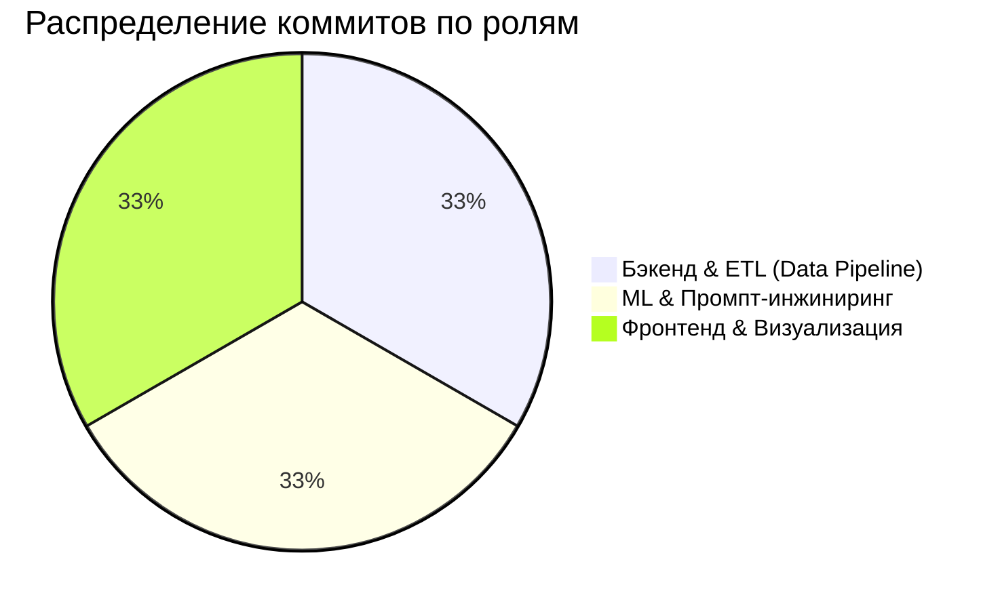

# 🏎️ ACC Telemetry Analyzer (Monza)

Интерактивная система трёхстороннего телеметрического анализа для Assetto Corsa Competizione с интеграцией нейросети Gemini в роли виртуального гоночного инженера.

## 👥 Команда проекта и распределение ролей



- **Бэкенд:** Парсер MoTeC CSV, очистка заголовков и интерполяция дистанции (`parser.py`).
- **ML & Аналитика:** Вычисление точек торможения, телеметрии секторов и промпт Gemini (`metrics.py`).
- **Фронтенд:** Визуализация телеметрии Plotly, кастомная тема MoTeC и Streamlit UI (`charts.py`, `app.py`, `.streamlit`).

## 🚀 Запуск проекта
```bash
pip install -r requirements.txt
streamlit run app.py
```